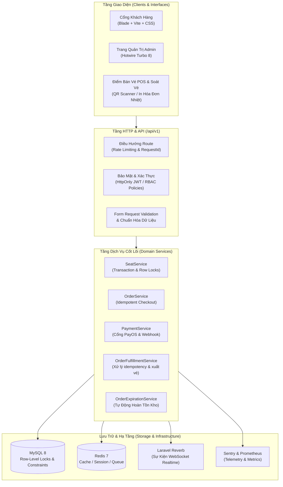

# Cinema — Nền Tảng Quản Trị & Đặt Vé Xem Phim Trực Tuyến

[](https://php.net)
[](https://laravel.com)
[](https://mysql.com)
[](https://redis.io)
[](https://tailwindcss.com)
[](phpstan.neon)

Cinema là ứng dụng quản lý rạp và đặt vé xem phim trực tuyến, xây dựng bằng Laravel 12. Repo gồm giao diện khách hàng, trang quản trị và POS; backend cung cấp API cho các luồng đặt vé, thanh toán và quản lý. MySQL lưu dữ liệu chính. Redis được cấu hình cho cache, session và queue; Laravel Reverb dùng để phát các sự kiện cập nhật khi được bật trong môi trường.

---

## Sơ đồ kiến trúc



---

## Các phần chính

### 1. Giữ ghế
- Khi giữ ghế, `SeatService` dùng transaction và khóa các bản ghi liên quan bằng `SELECT ... FOR UPDATE` trước khi kiểm tra ghế đã đặt hoặc đang được giữ.
- Bảng `seat_hold_items` có khóa duy nhất cho lượt giữ còn hiệu lực. Redis không dùng để khóa ghế.
- Job dọn các lượt giữ ghế và đơn hàng đã hết hạn.

### 2. Thanh toán
- Luồng PayOS kiểm tra chữ ký webhook và ghi nhận idempotency trong cơ sở dữ liệu để xử lý các lần gửi lặp.
- `OrderFulfillmentService` cập nhật đơn hàng và tạo vé trong transaction; các tác vụ gửi email được đưa vào queue.

### 3. Cập nhật ghế
- `SeatService` phát sự kiện khi trạng thái ghế thay đổi. Laravel Reverb chuyển các sự kiện này đến client nếu broadcast được bật và dịch vụ Reverb đang chạy.

### 4. Tài khoản và quyền
- Các route và policy giới hạn thao tác theo vai trò người dùng.
- Audit log lưu lại một số thao tác quản trị và thay đổi liên quan đến đơn hàng.

---

## Cài đặt local

### Yêu cầu môi trường
- PHP 8.2+ (kèm các extension: `pdo_mysql`, `redis`, `gd`, `bcmath`)
- Node.js 20+ & npm
- MySQL 8.0+
- Redis 7.0+ (hoặc dùng driver array/sync cho môi trường dev)

### Các bước cài đặt

```powershell
# 1. Clone mã nguồn
git clone https://github.com/nguyentruongsonn/cinema.git
cd cinema

# 2. Cài đặt các gói phụ thuộc Backend & Frontend
composer install
npm ci

# 3. Cấu hình môi trường
Copy-Item .env.example .env
php artisan key:generate

# 4. Migrate database và tạo dữ liệu mẫu
php artisan migrate --seed

# 5. Build assets giao diện
npm run build

# 6. Khởi chạy máy chủ Laravel
php artisan serve
```

### Môi trường phát triển (Dev Server)

```powershell
composer dev
```
*Lệnh này khởi chạy đồng thời Laravel server, queue listener, log tailing và Vite dev server.*
